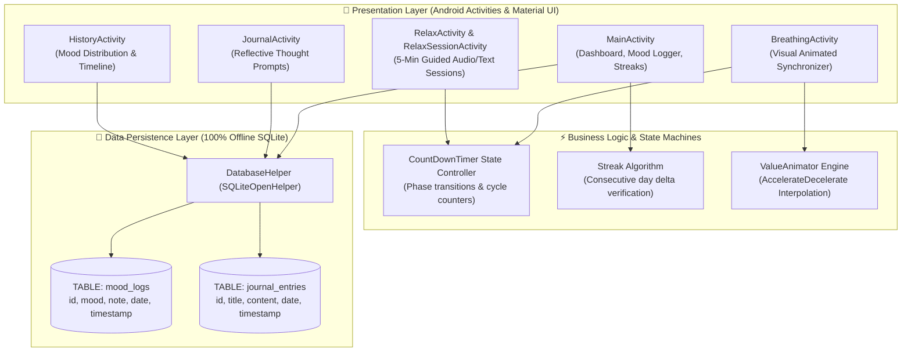

# MindTracker — Native Android Mental Health & Mindfulness Suite 🧠📱

<div align="center">

[-3DDC84?style=for-the-badge&logo=android&logoColor=white)](https://developer.android.com/)
[](https://www.java.com/)
[](https://www.sqlite.org/)
[](https://github.com/prachizala/mental-health-tracker-android/actions)
[](https://material.io/)
[](https://opensource.org/licenses/MIT)

<p align="center">
  A production-ready, native Android mindfulness, mood analytics, and habit-tracking suite engineered with <b>Java 8+</b>, <b>Android SDK API 34</b>, custom interpolator-driven UI animations, and <b>100% private, zero-telemetry offline SQLite storage</b>.
</p>

</div>

---

> [!IMPORTANT]
> **Academic & Self-Care Disclaimer:** This application is developed strictly for educational, academic, and personal wellness self-tracking purposes. It is **NOT** a clinical diagnostic medical device or a replacement for licensed psychiatric healthcare, therapy, or emergency crisis intervention.

---

## 🌟 Key Highlights & Engineering Features

- 🔒 **100% Private & Zero-Cloud Telemetry:** In an era of invasive data harvesting, all mood logs, private journal entries, and reflection timestamps remain **strictly on the user's local device** in an encrypted-at-rest SQLite database. No external trackers, no analytics SDKs, zero internet permission required.
- 💨 **Dynamic Breathing Synchronizer:** Real-time animated breathing circle utilizing Android `ValueAnimator` with `AccelerateDecelerateInterpolator` simulating physiological lung expansion and contraction across 3 clinical patterns.
- 🧘 **5-Minute Guided Decompression Sessions:** Fully timed state-machine guided sessions (Mindfulness, Body Scan, Nature Visualization, Gratitude, Affirmations) with custom phase instructions and progress tracking.
- 📊 **Streak & Habit Intelligence Engine:** Serverless, chronological date-traversal algorithm calculating consecutive daily logging streaks and mood frequency distributions.
- 🧪 **Test-Driven Reliability & CI/CD:** Unit tested with JUnit 4 and continuously validated via automated GitHub Actions CI.

---

## 🏗️ Architecture & Component Topology

The application follows clean architectural separation between Android UI Activities, domain timing state machines, and the encapsulated SQLite Data Access Object (DAO) layer:



---

## 📱 Core Functional Modules

### 1. 🏠 Home Dashboard & Daily Habit Streak
- **Time-Aware Dynamic Greeting:** Adapts interface context based on morning, afternoon, or evening system time.
- **5-Tier Likert Mood Selector:** Fast 1-tap logging ranging from *Awful (1)* to *Great (5)* with optional descriptive notes.
- **Consecutive Logging Streak Engine:** Evaluates daily delta timestamps to reward habit consistency.
- **Quick-Access Navigation Matrix:** Instant routing to all mindfulness sub-modules via Material CardViews.

### 2. 💨 Breathing Synchronizer Engine
Visual pulse animation with configurable target cycles (default: 5 cycles) and automated countdown transitions:
| Pattern | Cadence | Primary Clinical / Mindfulness Benefit |
| :--- | :--- | :--- |
| **4-7-8 Breathing** | Inhale: 4s • Hold: 7s • Exhale: 8s | Parasympathetic nervous system activation, anxiety reduction |
| **Box Breathing** | Inhale: 4s • Hold: 4s • Exhale: 4s • Hold: 4s | Tactical stress relief, heightened cognitive focus |
| **4-4-2 Energizer** | Inhale: 4s • Hold: 4s • Exhale: 2s | Rapid tension release and midday alertness |

### 3. 🧘 5-Minute Guided Relaxation Sessions
Fully orchestrated multi-phase exercises with dedicated instruction cards and countdown timers:
- 🌿 **Mindfulness Meditation:** Present-moment breath grounding.
- 🧘‍♂️ **Progressive Body Scan:** Head-to-toe somatic tension release.
- 🌊 **Peaceful Visualization:** Nature and coastal sensory decompression.
- 🙏 **Gratitude Practice:** Cognitive reframing through appreciative recall.
- ✨ **Positive Affirmations:** Internal resilience and cognitive empowerment.

### 4. 📓 Private Thought Journal
- Thought cataloging with auto-generated reflective writing prompts to overcome writer's block.
- Reverse-chronological historical card deck with snippet previews and full-text expansion.

### 5. 📊 Mood History & Descriptive Analytics
- Frequency distribution array calculating logs across all 5 emotional tiers.
- Chronological timeline cards displaying historical mood levels, custom annotations, and formatted dates.

---

## 🗄️ Database Schema & Data Models

Managed locally via `DatabaseHelper.java` (`SQLiteOpenHelper`):

```sql
-- Mood tracking entries
CREATE TABLE mood_logs (
    id INTEGER PRIMARY KEY AUTOINCREMENT,
    mood INTEGER NOT NULL,          -- Integer 1 (Very Bad) to 5 (Very Good)
    note TEXT,                      -- User reflection annotation
    date TEXT NOT NULL,             -- ISO yyyy-MM-dd
    timestamp LONG NOT NULL         -- Epoch milliseconds
);

-- Reflective journal entries
CREATE TABLE journal_entries (
    id INTEGER PRIMARY KEY AUTOINCREMENT,
    title TEXT,                     -- Prompt topic or user title
    content TEXT NOT NULL,          -- Body reflection
    date TEXT NOT NULL,             -- ISO yyyy-MM-dd
    timestamp LONG NOT NULL         -- Epoch milliseconds
);
```

---

## 🧪 Unit Testing & Verification

The project includes isolated domain unit tests in `app/src/test/java/com/mentalhealth/tracker/BreathingAndMoodLogicTest.java`:

- `testBreathingPatternDurations`: Verifies exact phase sum calculations (4-7-8 = 19s, Box = 16s, 4-4-2 = 10s).
- `testMoodLevelBoundaries`: Asserts strict boundary enforcement for mood levels 1 through 5.
- `testStreakCalculationLogic`: Validates consecutive multi-day streak accumulation algorithm.
- `testStreakBreakLogic`: Tests streak reset behavior on skipped calendar dates.

Run tests locally via the bundled Gradle wrapper:
```bash
./gradlew testDebugUnitTest
```

---

## 🚀 Getting Started & Local Development

### Prerequisites
- **Android Studio** Hedgehog (2023.1.1+) or newer
- **JDK:** OpenJDK 17+
- **Android SDK:** API Level 34 (Compile & Target), API 24+ (Minimum)

### Build & Run
1. **Clone the repository:**
   ```bash
   git clone https://github.com/prachizala/mental-health-tracker-android.git
   cd mental-health-tracker-android
   ```
2. **Compile and execute unit tests:**
   ```bash
   # On macOS / Linux
   ./gradlew testDebugUnitTest

   # On Windows
   .\gradlew.bat testDebugUnitTest
   ```
3. **Assemble Debug APK:**
   ```bash
   .\gradlew.bat assembleDebug
   ```
   The compiled APK will be located at `app/build/outputs/apk/debug/app-debug.apk`.

---

## 📂 Project Structure

```
mental-health-tracker-android/
├── .github/
│   └── workflows/
│       └── android-ci.yml           ← Automated GitHub Actions CI pipeline
├── app/
│   ├── src/
│   │   ├── main/
│   │   │   ├── java/com/mentalhealth/tracker/
│   │   │   │   ├── MainActivity.java           ← Dashboard & streak engine
│   │   │   │   ├── BreathingActivity.java      ← Animated breathing synchronizer
│   │   │   │   ├── RelaxActivity.java          ← Session menu
│   │   │   │   ├── RelaxSessionActivity.java   ← Timed guided relaxation
│   │   │   │   ├── JournalActivity.java        ← Offline thought journal
│   │   │   │   ├── HistoryActivity.java        ← Mood history & analytics
│   │   │   │   └── DatabaseHelper.java         ← SQLite DAO & schema manager
│   │   │   ├── res/
│   │   │   │   ├── layout/                     ← Material UI XML layouts
│   │   │   │   ├── drawable/                   ← Custom shapes & vector assets
│   │   │   │   ├── mipmap-*/                   ← Launcher icons
│   │   │   │   └── values/                     ← Themes, colors, styles
│   │   │   └── AndroidManifest.xml
│   │   └── test/java/com/mentalhealth/tracker/
│   │       └── BreathingAndMoodLogicTest.java  ← Domain JUnit 4 test suite
│   └── build.gradle
├── gradle/wrapper/                             ← Official Gradle 8.9 wrapper
├── gradlew & gradlew.bat
├── gradle.properties
├── build.gradle
└── settings.gradle
```

---

## 📄 License

This project is licensed under the [MIT License](LICENSE) — free for educational, personal, and research usage.

---

<div align="center">
  <sub>Developed with ❤️ by <a href="https://github.com/prachizala">Prachi Zala</a> • BCA Student @ Shanti Business School, Ahmedabad</sub>
</div>
